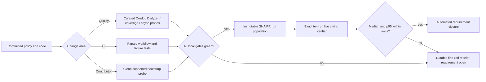

# Phase 136: Measured Quality and CI Ratchets — Research

**Researched:** 2026-10-20
**Domain:** Elixir quality gates, evidence led CI, contributor verification
**Confidence:** HIGH for repository mechanics; MEDIUM for the unrun supported-cell and live timing outcomes

## User Constraints

No `136-CONTEXT.md` exists; the user explicitly chose research before planning without a discussion artifact. [VERIFIED: `.planning/phases/136-measured-quality-and-ci-ratchets/` via `init.phase-op 136`; user task] The binding phase scope is the Roadmap and seven Requirements below. [VERIFIED: `.planning/ROADMAP.md:441-453`; `.planning/REQUIREMENTS.md:36-44`]

<phase_requirements>
## Phase Requirements

| ID | Description (verbatim) | Research support |
|---|---|---|
| MAINT-04 | The reviewed complexity baseline cannot grow; each removal has behavior-preservation evidence, while retained findings keep stable identity and a removal trigger. | Existing Credo JSON baseline and normalizer; replace fixed-count contract with removal-only subset plus provenance. [VERIFIED: `.planning/REQUIREMENTS.md:38`; `scripts/maintainer/credo_quality_normalize.exs:61-89`] |
| TYPE-03 | Dialyzer suppressions are removal-only, narrowly identity-matched, and validated on the supported toolchain without substitution or broader ignores. | Exact allowlist test and Nightly fresh/restored runner. [VERIFIED: `.planning/REQUIREMENTS.md:39`; `test/install_smoke/dialyzer_ignore_policy_test.exs:48-95`; `scripts/ci/run_nightly_dialyzer.sh:121-147`] |
| COV-06 | A fresh canonical coverage run preserves or raises the exact accepted floor, while changed risk branches receive behavioral rather than percentage-driven tests. | Single-run local+JSON command, floor discrepancy, behavior probes. [VERIFIED: `.planning/REQUIREMENTS.md:40`; `RUNNING.md:98-111`; `coveralls.json:1-5`] |
| TEST-08 | Issue #42's finite async-isolation experiment completes or remains open with a reproducible failure, explicit uncertainty, and evidence-based next trigger. | Existing fixed-seed, no-clobber local runner and fixture tests. [VERIFIED: `.planning/REQUIREMENTS.md:41`; `scripts/maintainer/async_isolation_evidence.sh:5-23,65-114`] |
| CI-15 | Workflow semantics, caches, downloads, images, and process-heavy jobs are structurally validated, immutable or checksum-verified where practical, and bounded by justified timeouts. | Parsed YAML tests plus new source-integrity and timeout audit. [VERIFIED: `.planning/REQUIREMENTS.md:42`; `test/install_smoke/quality_signal_policy_test.exs:8-36`] |
| CI-16 | CI changes preserve `ci.yml`, workflow `CI`, the sole `CI Summary` required context, exact-SHA release gating, fork safety, and the <=480-second median/<=600-second p95 PR envelope. | Structured required-check authority and exact-ten live timing sampler. [VERIFIED: `.planning/REQUIREMENTS.md:43`; `config/ci_required_checks.json:1-11`; `scripts/ci/collect_pr_timing_receipt.sh:29-50,147-218`] |
| DX-05 | A contributor can bootstrap a clean supported environment and select the correct focused or full verification command without reverse-engineering workflow YAML. | Add executable command map to existing contributor guide and test it in clean supported environment. [VERIFIED: `.planning/REQUIREMENTS.md:44`; `CONTRIBUTING.md:15-88`] |
</phase_requirements>

## Summary

Phase 136 should ratchet existing authorities, not introduce new packages or a separate quality framework. The project already has a curated Credo inventory, exact Dialyzer ignore allowlist, a single canonical coverage command, fixture-backed async runner, parsed workflow tests, and a live PR timing receipt controller. [VERIFIED: `scripts/maintainer/credo_quality.sh:24-45`; `test/install_smoke/dialyzer_ignore_policy_test.exs:48-95`; `RUNNING.md:98-129`; `test/install_smoke/quality_signal_policy_test.exs:8-36`; `scripts/ci/collect_pr_timing_receipt.sh:29-50`] The present gaps are specific: complexity normalization hard-codes the current count and thereby resists removal; `coveralls.json` states a 69% gate while the last accepted exact result is 82.1343%; the CI downloads and MinIO image remain rolling inputs; and contributor documentation starts at `mix ci` without an executable clean-machine bootstrap. [VERIFIED: `scripts/maintainer/credo_quality_normalize.exs:61-64`; `coveralls.json:1-5`; `.planning/PROJECT.md:94-97`; `scripts/ci/install_ffmpeg.sh:20-69`; `.github/actions/setup-minio/action.yml:20-43`; `CONTRIBUTING.md:15-59`]

The Roadmap says Phase 136 **depends on Phase 135**. Phase 135 has no plans yet and Phase 133 remains the current phase, so Phase 135 completion is an execution gate, not evidence that this research can borrow. The `133-136-PLAN.md` file belongs to Phase 133's recovery Wave 11 and is unrelated to this phase number. [VERIFIED: `.planning/ROADMAP.md:427-453`; `.planning/STATE.md:1-43`; `.planning/ROADMAP.md:85-93`]

**Primary recommendation:** Plan finite, independent ratchets around existing executable gates; require fresh supported-cell evidence and a separate exact-ten PR receipt only after the relevant code and CI topology have settled. [VERIFIED: `.planning/ROADMAP.md:441-453`; `RUNNING.md:89-111`; `scripts/ci/collect_pr_timing_receipt.sh:147-218`]

## Architectural Responsibility Map

| Capability | Primary tier | Secondary tier | Rationale |
|---|---|---|---|
| Credo, Dialyzer, coverage, async evidence | Repository test/probe layer | CI runner | The scripts and ExUnit tests define policy; CI invokes them. [VERIFIED: `scripts/maintainer/credo_quality.sh:24-45`; `test/install_smoke/dialyzer_ignore_policy_test.exs:48-95`; `RUNNING.md:98-129`] |
| Workflow topology, input integrity, timeouts | GitHub Actions configuration | Repository semantic tests | Workflow YAML owns execution; parsed tests and shell fixtures reject drift. [VERIFIED: `.github/workflows/ci.yml:1-43`; `test/install_smoke/quality_signal_policy_test.exs:8-36`] |
| PR speed acceptance | GitHub Actions live run state | Local receipt verifier | The ten run IDs, SHA, terminal conclusions and durations must be authenticated against Actions. [VERIFIED: `scripts/ci/collect_pr_timing_receipt.sh:147-218`] |
| Contributor bootstrap | Documentation and reproducible script | Host runtime | The supported toolchain and prerequisites precede focused/full Mix commands. [VERIFIED: `.tool-versions:1-2`; `CONTRIBUTING.md:15-88`] |

## Project Constraints (from AGENTS.md)

- Keep project model overrides aligned with intentional routing changes, and use fail-closed worktree isolation where available. [VERIFIED: `AGENTS.md:3-17`]
- Follow `RUNNING.md` and `guides/release_publish.md`; keep edits focused; run the change-appropriate checks; update `.planning/PROJECT.md` only for intentional product-scope or shipped-claim changes. [VERIFIED: `AGENTS.md:19-27`]
- Close active requirements through executable tests, probes, or evidence collectors. Human checkpoints authorize credentials or irreversible actions only; they do not count as acceptance. Run `./scripts/maintainer/automation_first_contract.sh` after active planning artifact changes. [VERIFIED: `AGENTS.md:29-34`]
- Keep merge-blocking main green, prefer PR-first feature work, avoid speculative milestone reopening during demand-gated pause, and run `./scripts/maintainer/repo_hygiene_check.sh` before release preparation. [VERIFIED: `AGENTS.md:36-46`]
- If the phase touches UI/admin-console surfaces, read `guides/ui_principles.md` first. [VERIFIED: `AGENTS.md:35`]

## Standard Stack

Use the already locked Elixir 1.17.3 / OTP 27.2 primary toolchain (also test CI's Elixir 1.15/OTP 26 matrix where affected), Mix/ExUnit, Credo, Dialyxir, ExCoveralls, `YamlElixir`, Bash, jq, Node, and GitHub Actions. These are existing repository dependencies, not proposed installations. The checked-in version declarations are verbatim: `elixir 1.17.3-otp-27`, `erlang 27.2`; `{:credo, "~> 1.7"}`, `{:dialyxir, "~> 1.4"}`, `{:yaml_elixir, "~> 2.12"}`, and `{:excoveralls, "~> 0.18"}`. [VERIFIED: `.tool-versions:1-2`; `mix.exs:123-128`; `.github/workflows/ci.yml:43-55`] No package legitimacy audit is needed if the plans add no external package. [VERIFIED: `mix.exs:73-133`; phase scope in `.planning/ROADMAP.md:441-453`]

## Architecture Patterns



1. **Removal-only ledgers.** Keep approved identities immutable as a maximum set, compare observed findings to a subset, and attach owner/removal trigger to every retained entry. A disappearance must have behavioral test evidence and the baseline deletion; a new identity, metric increase, or broader Dialyzer discriminator fails. The current normalizer uses identity keys `"check", "file", "trigger", "observed_metric"` and currently requires `27` identities / `31` occurrences; those literal values must become an upper-bound history, not an exact live count. [VERIFIED: `scripts/maintainer/credo_quality_normalize.exs:1-3,61-89`; `scripts/maintainer/credo_quality.sh:32-45`; `test/install_smoke/dialyzer_ignore_policy_test.exs:48-95`]
2. **Exact subject, single run coverage.** Preserve the one suite invocation `mix coveralls.multiple --type local --type json`; `local` carries the threshold, JSON is the side artifact. The historical accepted measurement is `82.1343%`, while current `minimum_coverage` is `69`. Preserve or raise the accepted *measured* floor from one fresh canonical run before deciding the machine gate's representable precision; record covered/relevant counts and the exact subject. Never treat the old historical measurement alone as a current-head pass. [VERIFIED: `RUNNING.md:98-111`; `.planning/PROJECT.md:94-97`; `coveralls.json:1-5`; `.planning/REQUIREMENTS.md:40`]
3. **Durable bounded experiments.** Use the existing async runner's verbatim seed plan `0 17 43 71 101 131 173 211 257 307 353 401 449 503 557 601 653 701 757 809 863 911 967 1013 1061`; it writes new JSONL only and stops on the first red. Existing data saying `1/25` is a historical incomplete experiment, not a fresh pass. Add an automated receipt validator for run count, seed order, SHA/toolchain consistency, stop rule, file no-clobber, and a machine-readable unresolved outcome with next trigger. [VERIFIED: `scripts/maintainer/async_isolation_evidence.sh:5-23,65-114`; `.planning/research/FEATURES.md:75`]
4. **Semantic workflow proof.** Build on `YamlElixir.read_from_file!` and job/step navigation already used by `quality_signal_policy_test.exs`, then add mutation fixtures for wrong needs/if/timeout/cache/action/image/download values. Keep shell fixtures for executable scripts. A source literal alone is too easy to satisfy in a comment or another job. [VERIFIED: `test/install_smoke/quality_signal_policy_test.exs:8-36,86-99`; `test/install_smoke/ci_cache_hygiene_test.exs:74-143`; `test/install_smoke/ci_lane_split_test.exs:141-150`]
5. **Timing after topology stabilization.** Preserve the structured authority verbatim: `"file": "ci.yml"`, `"name": "CI"`, `"job_id": "ci-summary"`, `"CI Summary"`. The controller defaults are `samples=10`, `median_max=480`, `p95_max=600`; its verifier checks live run identity, exact SHA, terminal success and complete eligible population. Reuse it after any topology change; do not edit its historical Phase 132-specific manifest mode merely to label a Phase 136 receipt. [VERIFIED: `config/ci_required_checks.json:3-10`; `scripts/ci/collect_pr_timing_receipt.sh:29-50,147-218`]

### Recommended project structure

Extend existing owners: `scripts/maintainer/` for policy and evidence collectors; `test/install_smoke/` for default-suite semantic tests; `scripts/ci/` and `.github/workflows/` for execution wiring; `CONTRIBUTING.md` and `RUNNING.md` for the command map. These directories and files already exist. [VERIFIED: `scripts/maintainer/credo_quality.sh:1-5`; `test/install_smoke/quality_signal_policy_test.exs:1-9`; `.github/workflows/ci.yml:1-43`; `CONTRIBUTING.md:15-88`; `RUNNING.md:40-100`]

## Don't Hand-Roll

| Problem | Use existing authority | Reason |
|---|---|---|
| Coverage gate plus artifact | `mix coveralls.multiple --type local --type json` | Already runs one suite with the gating local analyzer. [VERIFIED: `RUNNING.md:98-111`] |
| Required context or release truth | `config/ci_required_checks.json`, `validate_live_truth.exs`, CI Summary scripts | One structured check identity and exact-release coupling already exist. [VERIFIED: `config/ci_required_checks.json:1-11`; `RUNNING.md:178-197`] |
| PR timing sample | `collect_pr_timing_receipt.sh` | Authenticates the ten-run population against GitHub. [VERIFIED: `scripts/ci/collect_pr_timing_receipt.sh:147-218`] |
| Dialyzer PLT operation | `run_nightly_dialyzer.sh fresh/restored` | Handles safe PLT containment and one narrow old-PLT recovery fingerprint. [VERIFIED: `scripts/ci/run_nightly_dialyzer.sh:39-100,121-147`] |

## Runtime State Inventory

This phase includes potential refactors to measured quality code; these five categories need explicit plan treatment. Stored data: test Postgres data is recreated by the Mix alias (`ecto.create`, `ecto.migrate`), so runtime data migration should be excluded unless a chosen candidate changes persisted schemas. Live service config: GitHub branch protection and Actions run state are remote; verify them rather than inferring from YAML. OS registrations: none identified from the phase's quality/CI scope; confirm before any installer change. Secrets/env vars: CI token and optional live-service secrets remain at the GitHub boundary; tests must use fixtures/redaction, never echo values. Build artifacts: Mix `_build`, `deps`, Dialyzer PLT and coverage JSON can carry stale toolchain/source state; acceptance needs fresh or exact-hash evidence. [VERIFIED: `mix.exs:310-325`; `RUNNING.md:178-197`; `.github/workflows/ci.yml:118-120`; `scripts/ci/run_nightly_dialyzer.sh:19-29,96-105`; `.github/actions/setup-elixir/action.yml:78-105`] No rename target was identified; these are state categories to audit at execution, not migration claims. [ASSUMED]

## Common Pitfalls

- **A count lock blocks a removal.** Current baseline validation insists on 27 identities and 31 occurrences, then exact `cmp`; deleting a finding fails even though the policy calls for removal-only. Replace fixed-count acceptance with subset semantics and mutation tests that still reject additions and metric increases. [VERIFIED: `scripts/maintainer/credo_quality_normalize.exs:61-64`; `scripts/maintainer/credo_quality.sh:40-43`; `.planning/REQUIREMENTS.md:38`]
- **Configured gate confused with accepted measurement.** `69` is the current configured threshold, while `82.1343%` is the prior accepted exact result. A green 69% gate alone cannot close COV-06. [VERIFIED: `coveralls.json:1-5`; `.planning/PROJECT.md:94-97`; `.planning/REQUIREMENTS.md:40`]
- **Unsupported local toolchain credited as acceptance.** `.tool-versions` pins OTP 27.2 but the current `elixir --version`/`mix --version` shims return `No version is set for command erl`; use supported CI or install the pinned local version before Mix proof. [VERIFIED: `.tool-versions:1-2`; local command probe 2026-10-20]
- **Rolling inputs bypass immutable-input intent.** FFmpeg resolves a latest GitHub release and downloads its URL; setup-minio runs `minio/minio` and downloads `mc` from a mutable URL. Plan exact digest/checksum verification or defensible exception with fail-closed fixture proof. [VERIFIED: `scripts/ci/install_ffmpeg.sh:20-69`; `.github/actions/setup-minio/action.yml:20-43`; `.planning/REQUIREMENTS.md:42`]
- **A timing table becomes detached from current topology.** Historical 453s/481s is a prior milestone result. CI-16 requires a fresh exact-ten receipt after topology changes, authenticated to its SHA and full eligible population. [VERIFIED: `.planning/PROJECT.md:94-97`; `scripts/ci/collect_pr_timing_receipt.sh:147-218`; `.planning/ROADMAP.md:451-453`]
- **Source text tests pass for the wrong job or comments.** Parsed-YAML tests already exist; extend their semantic pattern and use mutation fixtures. [VERIFIED: `test/install_smoke/quality_signal_policy_test.exs:8-36`; `test/install_smoke/ci_lane_split_test.exs:141-150`]

## Code Examples

```sh
# Existing read-only matrix inspection. The exact command is documented in RUNNING.md.
bash scripts/maintainer/async_isolation_evidence.sh --validate

# Existing focused structural checks once supported Elixir/OTP is active.
mix test test/install_smoke/quality_signal_policy_test.exs test/install_smoke/dialyzer_ignore_policy_test.exs

# Existing canonical coverage, after environment and subject are frozen.
mix coveralls.multiple --type local --type json
```

The commands above are quoted verbatim by their sources. [VERIFIED: `RUNNING.md:98-129`; `test/install_smoke/quality_signal_policy_test.exs:1-9`; `test/install_smoke/dialyzer_ignore_policy_test.exs:1-5`] Do not run the finite async `--report` experiment, fresh PLT analysis, or ten live PR samples during planning; execution needs their fresh committed subject and complete prerequisites. [VERIFIED: `.planning/ROADMAP.md:441-453`; `scripts/maintainer/async_isolation_evidence.sh:65-114`; `scripts/ci/collect_pr_timing_receipt.sh:187-218`]

## State of the Art

The current repository design already separates PR critical-path work from push-main and Nightly breadth; its single required context is the aggregate `CI Summary`. The Phase 136 job is to prove the existing split structurally and with fresh timing, preserving exact SHA release coupling. [VERIFIED: `RUNNING.md:40-96,178-197`; `.planning/ROADMAP.md:441-453`] Do not reopen alternative CI topologies without measured evidence. [VERIFIED: `.planning/PROJECT.md:18-20`; `.planning/REQUIREMENTS.md:43`]

## Assumptions Log

| # | Claim | Section | Risk if wrong |
|---|---|---|---|
| A1 | No non-repository runtime state needs migration for this refactor scope. [ASSUMED] | Runtime State Inventory | Could miss external branch-protection or service configuration; execution audit must check. |
| A2 | The historical accepted exact coverage can be represented by a suitable machine gate without incompatible rounding. [ASSUMED] | Architecture Patterns | Plan must run a fresh result and test ExCoveralls threshold behavior before locking a value. |

## Execution Decision Rules — Planning Resolved, Outcomes Unmeasured

1. **Coverage counts:** The planning decision is an exact accepted floor of 82.1343% computed from covered/relevant counts, with a separately tested representable local threshold. Finish and commit source, tests and `coveralls.json` first, persist that commit/tree in `136-SUBJECT.json`, then run `mix coveralls.multiple --type local --type json` once in Plan 11's action. Plan 11 verification only consumes its receipt. If exact counts meet the floor and the local gate passes, COV-06 may close; otherwise preserve the first-red receipt and leave COV-06 open. The fresh counts are an execution observation, not a missing planning choice. [VERIFIED: `.planning/PROJECT.md:94-97`; `.planning/REQUIREMENTS.md:40`]
2. **Issue #42 outcome:** Use the existing fixed 25-seed order and a new no-clobber target from a detached checkout of the pinned subject commit. All 25 green yields `complete`; the first red yields `open`, with location, uncertainty and evidence-based next trigger, without rewriting earlier reports. The seed outcome is intentionally unmeasured during planning. [VERIFIED: `.planning/research/FEATURES.md:75`; `scripts/maintainer/async_isolation_evidence.sh:65-114`]
3. **CI integrity and speed:** Pin or checksum-verify the identified mutable FFmpeg and MinIO inputs and prove actual consumer semantics by parsed/fake-command fixtures. Freeze topology and source, then invoke current-subject controller mode from a detached checkout of the persisted commit for exactly ten authenticated PR runs, even if evidence-only commits have advanced the main checkout. Median <=480 seconds and p95 <=600 seconds permits CI-16 speed closure; over-budget or unavailable population preserves red/blocked evidence and leaves CI-16 open. Do not weaken topology or supply integrity to obtain speed. The practical runtime result is an execution measurement, not an undecided design option. [VERIFIED: `.planning/REQUIREMENTS.md:42-43`; `scripts/ci/collect_pr_timing_receipt.sh:29-50`]

## Environment Availability

| Dependency | Required by | Availability at research | Fallback |
|---|---|---|---|
| Elixir/Mix with OTP 27.2 | Supported local qualification | Shim present; invocation fails: `No version is set for command erl`. [VERIFIED: local command probe 2026-10-20; `.tool-versions:1-2`] | Use supported CI cell or install pinned local runtime before acceptance. |
| Node | Existing scripts/tests | `v26.10.0` shell probe. The current `.tool-versions` has only the verbatim entries `elixir 1.17.3-otp-27` and `erlang 27.2`; the required Node version must be resolved from the relevant CI job or documented bootstrap contract rather than inferred from a stale test literal. [VERIFIED: local command probe 2026-10-20; `.tool-versions:1-2`; `test/install_smoke/ci_cache_hygiene_test.exs:145-157`] | Select the CI-defined Node version for authoritative bootstrap. |
| GitHub CLI | Live timing | `gh version 2.101.0` present. [VERIFIED: local command probe 2026-10-20] | Fixture tests first; live credentials/runs only at execution. |
| jq | Receipt verifier | `jq-1.7.1-apple` present. [VERIFIED: local command probe 2026-10-20] | None needed. |
| GitHub Actions / Postgres / MinIO / FFmpeg | Integration and CI acceptance | CI workflows provision these; no live availability or qualification was probed. [VERIFIED: `.github/workflows/ci.yml:63-118`; `.github/actions/setup-minio/action.yml:17-43`] | Use CI after phase dependency and subject readiness; keep acceptance open meanwhile. |

## Validation Architecture

**Framework:** Existing ExUnit (`mix test`), Bash fixture tests, and the GitHub Actions live receipt verifier. `test/install_smoke/quality_signal_policy_test.exs` already parses YAML; the default Mix suite executes `test` once via `mix ci`. [VERIFIED: `test/install_smoke/quality_signal_policy_test.exs:1-9`; `mix.exs:310-325`]

| Requirement | Fast automated probe to build/use | Final authority |
|---|---|---|
| MAINT-04 | Extend `quality_signal_policy_test.exs` or dedicated ledger fixture tests; run `mix credo_quality` on supported cell. [VERIFIED: `mix.exs:286-291`] | Monotone baseline plus behavior-preservation tests on every removed owner. |
| TYPE-03 | `mix test test/install_smoke/dialyzer_ignore_policy_test.exs`; `bash scripts/ci/test_nightly_dialyzer.sh`. [VERIFIED: `test/install_smoke/dialyzer_ignore_policy_test.exs:1-5`; `scripts/ci/test_nightly_dialyzer.sh:1-11`] | Supported 1.17/27 fresh and restored Nightly analysis with exact PLT evidence. [VERIFIED: `RUNNING.md:89-96`] |
| COV-06 | Focused behavioral tests for changed risk branches; one `mix coveralls.multiple --type local --type json`. [VERIFIED: `RUNNING.md:98-111`] | Fresh exact subject total and threshold with one suite run. |
| TEST-08 | `bash scripts/maintainer/async_isolation_evidence.sh --validate`; `mix test test/install_smoke/async_isolation_evidence_runner_test.exs`. [VERIFIED: `RUNNING.md:113-129`; `test/install_smoke/async_isolation_evidence_runner_test.exs:1-8`] | New no-clobber 25-seed or first-red receipt plus validator and next trigger. |
| CI-15 | Parsed workflow semantic tests, script fixtures, checksum/pin and timeout mutation cases. [VERIFIED: `test/install_smoke/quality_signal_policy_test.exs:8-36`; `scripts/ci/test_nightly_dialyzer.sh:1-11`] | Required CI lane green on PR. |
| CI-16 | Existing `ci_lane_split_test.exs`, `test_ci_summary_gate.sh`, `check_required_checks.sh`, live timing verifier. [VERIFIED: `test/install_smoke/ci_lane_split_test.exs:1-54`; `.github/workflows/ci.yml:1425-1473`; `config/ci_required_checks.json:1-11`] | Fresh exact-ten authenticated PR receipt <=480 median / <=600 p95 after topology changes. |
| DX-05 | Clean copied checkout/fixture bootstrap script that invokes supported runtime and maps focused/full commands; docs parity test. [ASSUMED] | Automated clean-environment exercise, not human walkthrough. [VERIFIED: `AGENTS.md:29-34`; `.planning/REQUIREMENTS.md:44`] |

**Wave 0 gaps:** add a fixture-backed complexity subset test, exact coverage receipt/threshold test, async receipt validator, parsed workflow security/timeout mutation tests, and clean contributor bootstrap probe. These are proposed tasks derived from the observed gaps. [VERIFIED: `scripts/maintainer/credo_quality_normalize.exs:61-64`; `coveralls.json:1-5`; `.planning/ROADMAP.md:446-453`] Run `./scripts/maintainer/automation_first_contract.sh` after editing the active plan/validation artifacts. [VERIFIED: `AGENTS.md:29-34`]

## Security Domain

Security enforcement is not set to false in `.planning/config.json`, so include this domain. [VERIFIED: `.planning/config.json` read 2026-10-20] The category names below use OWASP's ASVS 4.0.3 guide; ASVS numbering changes by version, so do not present this as a compliance audit. [CITED: https://devguide.owasp.org/en/06-verification/01-guides/03-asvs/]

| ASVS 4.0.3 category | Applies to this phase | Standard control |
|---|---|---|
| V2 Authentication | Indirectly, GitHub credential access | Preserve GitHub Actions token boundaries; no application authentication change. [VERIFIED: `.github/workflows/ci.yml:118-120`; `AGENTS.md:29-34`] |
| V3 Session Management | No application session change | Keep current app tests; this phase edits CI and quality gates. [VERIFIED: `.planning/ROADMAP.md:441-453`] |
| V4 Access Control | Yes, fork/repository/secret gates | Parse job conditions and minimal permissions. [VERIFIED: `.github/workflows/ci.yml:34-36,1347-1473`] |
| V5 Validation, Sanitization and Encoding | Yes, receipt/YAML/URL/digest inputs | Validate source identity, URLs, run populations and file boundaries in executable tests. [VERIFIED: `scripts/ci/collect_pr_timing_receipt.sh:147-218`; `scripts/ci/install_ffmpeg.sh:29-54`] |
| V6 Stored Cryptography | No application data cryptography change | Use standard checksum/digest tools for supply integrity; do not write cryptographic primitives. [ASSUMED] |

Threats to test: mutable downloads or images changing code under the same workflow (tampering); PR fork input or secrets reaching privileged jobs (elevation/disclosure); forged/skipped green summaries (repudiation); and unbounded jobs denying CI availability. These are phase-specific threat hypotheses, not observed compromises. [ASSUMED] GitHub documents full commit SHA action pinning and least-privilege workflow permissions, and documents `jobs.<job_id>.timeout-minutes` as the job time bound; the repository already uses SHA-pinned actions, so focus the new integrity audit on images and downloads as well. [CITED: https://docs.github.com/en/enterprise-cloud%40latest/code-security/tutorials/secure-your-organization/protect-against-threats] [CITED: https://docs.github.com/en/actions/reference/workflows-and-actions/workflow-syntax] [VERIFIED: `.github/workflows/ci.yml:78-80`; `.github/actions/setup-minio/action.yml:20-43`]

## Sources

- Primary repository authorities: `AGENTS.md`, `RUNNING.md`, `.planning/ROADMAP.md`, `.planning/REQUIREMENTS.md`, `.planning/PROJECT.md`, `.planning/STATE.md`, `mix.exs`, `coveralls.json`, `.dialyzer_ignore.exs`, quality/CI scripts and tests cited inline. All were read in this session. [VERIFIED: cited paths above]
- No new package or external framework was recommended; the repository's declared dependencies and executable contracts are the relevant authority for this phase. [VERIFIED: `mix.exs:123-128`; `.planning/ROADMAP.md:441-453`]
- [GitHub Actions workflow syntax](https://docs.github.com/en/actions/reference/workflows-and-actions/workflow-syntax) — job timeout semantics. [CITED: https://docs.github.com/en/actions/reference/workflows-and-actions/workflow-syntax]
- [GitHub Actions security guidance](https://docs.github.com/en/enterprise-cloud%40latest/code-security/tutorials/secure-your-organization/protect-against-threats) — SHA pinning and least-privilege permissions. [CITED: https://docs.github.com/en/enterprise-cloud%40latest/code-security/tutorials/secure-your-organization/protect-against-threats]
- [OWASP ASVS guide](https://devguide.owasp.org/en/06-verification/01-guides/03-asvs/) — version 4.0.3 category names. [CITED: https://devguide.owasp.org/en/06-verification/01-guides/03-asvs/]

## Metadata

**Confidence breakdown:** Standard stack HIGH (checked-in declarations); architecture HIGH (source and tests read); pitfalls HIGH for current implementation, MEDIUM for proposed remediations; live acceptance LOW until fresh supported-cell and GitHub run receipts exist. [VERIFIED: sources cited above]
**Valid until:** 2026-11-19 for repository mechanics, or sooner if Phase 135 changes these owners. [ASSUMED]
