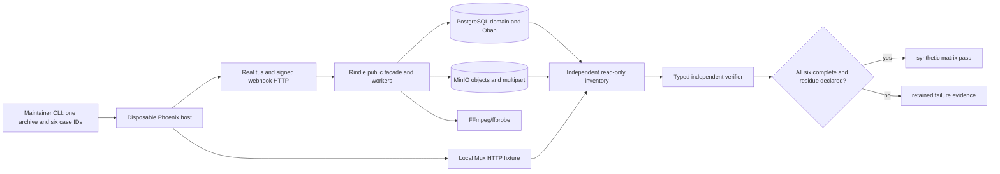

# Phase 138: Lifecycle Failure and Recovery Matrix — Research

**Researched:** 2026-10-21  
**Domain:** Packaged Phoenix lifecycle recovery, durable Oban work, S3/tus, FFmpeg, Mux webhooks and strict evidence  
**Confidence:** HIGH for existing contracts; MEDIUM for proposed provider ordering repair

<user_constraints>
## User Constraints (from CONTEXT.md)

### Locked Decisions and Codex Discretion

## Implementation Decisions

### Consumer boundary and finite matrix

- **D-138-01:** Extend the dedicated external Phoenix/Repo/default-Oban host from Phase
  137. Build one fresh Hex archive per matrix invocation and bind every case to the exact
  same archive bytes, source, host/lock/fixture/contract inputs and actual runtime versions.
  Compile Rindle uncached as required by the foundation. Isolate case state with distinct
  run identities and fresh disposable resources; one case must not satisfy another's oracle.
- **D-138-02:** Use public facade/configuration/behaviour, supported Mix tasks, actual HTTP
  endpoints and normal committed Oban scheduling. No SQL Sandbox, direct worker execution,
  manual job draining, lifecycle-row mutation, rewritten job schedules/attempts, private
  production hooks or checkout-backed consumer code. Read-only domain/Oban observations
  and narrowly host-owned persistent fixture state remain legitimate. Faults are fixed,
  exact-key/run-scoped behaviours, not a general fault platform.
- **D-138-03:** Keep six required scenario families with finite explicit sub-observations,
  not a combinatorial chaos/compatibility matrix. Every family must pass; partial runs are
  useful reproduction evidence but cannot pass full-matrix verification. Preserve the
  supported Elixir 1.17.3 / OTP 27.3.4.15 diagonal, root lock and toolchain declarations.

### Tus, storage retry and abrupt restart

- **D-138-04:** For RECOV-01, finish a nonfinal PATCH, record its acknowledged byte count,
  terminate/recreate the client process, and resume the same session using a fresh HEAD's
  authoritative offset. Keep the same S3 tus host/node and retained tail. Assert a wrong
  offset is rejected without advancement, one upload stimulus/session/asset, final source
  checksum, ready state and exact storage inventory. Describe this as interruption between
  committed PATCHes; do not claim a severed mid-PATCH socket or cross-node tail recovery.
- **D-138-05:** Interpret “one object” as exactly one original upload object, plus the
  explicitly configured derivative object(s) necessary for the shipped ready lifecycle.
  Name all permitted keys and reject extras. This clarifies the existing source/variant
  contract; it does not remove variants or change readiness semantics to hit a bucket count.
- **D-138-06:** For RECOV-02, reuse the committed exact-source delete-once fault. Observe
  retained durable asset state and the same purge job retryable at attempt one with a stored
  error. Pause and prove quiescence before independently removing the owned source key and
  establishing authoritative absence. Ordinary scheduling must complete that job at attempt
  two without another detach/stimulus. Verify final rows and objects independently. Missing
  unversioned S3 DELETE normally succeeds; never invent a provider 404 or mistake permission
  denial for absence. Keep explicit error-atom branch proof in focused behavioural tests.
- **D-138-07:** For RECOV-05, pause the promotion queue before upload completion. Require
  committed completed session/asset state, one persisted promotion job available at attempt
  zero, paused queue and no running work at the selected cut. SIGKILL only the host, observe
  old-runtime death, then boot a new runtime against the same package and durable resources.
  The same job ID must complete normally and converge without repeating upload/completion
  stimulus. Record old/new runtime identities. This is an abrupt between-stages crash proof;
  executing-job rescue, controller recovery and disk loss remain outside the claim.

### Real AV failure, diagnostics and supported repair

- **D-138-08:** AV means audio/video. Use one tiny valid video fixture with audio and one
  supported video derivative, real FFmpeg/ffprobe, actual MinIO I/O and ordinary media queue
  execution. After valid promotion, apply a fixed exact-source download fault through the
  host's configurable storage wrapper: delegate real download, then replace only that worker
  temp input with malformed bytes. Prove the real processor rejects it; do not stub a
  processor result, remove binaries or claim storage corruption as an observed root cause.
- **D-138-09:** Retain the fault through the shipped five-attempt budget, observing the
  failed variant, discarded job, actual attempts/errors and public `Rindle.runtime_status/1`
  failure classification. Restore normal downloads and use `Rindle.requeue_variants/2` for
  the selected variant. Require a genuinely enqueued repair and a consistent ready terminal
  state, then download, probe and fully decode the output. Record actual binary versions.
  Use bounded state polling with execution/scheduler margin, not an estimated retry sum as
  a guarantee. No backoff patch, attempt shortcut or automatic retry masquerading as repair.

### Provider convergence and bounded correctness fixes

- **D-138-10:** Exercise the shipped Mux adapter and its existing optional SDK through
  supported `base_url` configuration aimed at a minimal isolated local HTTP fixture. Use
  dummy credentials, actual signed raw-body webhook ingress and the ordinary provider queue.
  Activate the already locked optional SDK only in the host if needed. Prefer this over a
  replacement provider implementation, a new mocking dependency or a paid/cloud account.
  Claim local adapter/protocol evidence, never real-cloud parity or adoption.
- **D-138-11:** Include duplicates both while the first event job is pending and after it
  completes; include a newer ready event followed by older created AND older errored events.
  Assert converged provider identity/state, nonregressing event watermark, bounded declared
  jobs, exactly one intended outbound create and no duplicate observable lifecycle effects.
  A post-completion handler job is legitimate if effect-free; completed-job uniqueness is
  not an exactly-once guarantee. Capture allowlisted telemetry/PubSub effects and scan secrets.
  Do not narrow the fixture to the one out-of-order edge the current FSM already rejects.
- **D-138-12:** A confirmed stale-event regression or duplicate-effect defect belongs in
  this approved correctness slice: first reproduce behaviour, then fix its cohesive owner
  with regression proof. Preserve public APIs, schema, supported fresh-event transitions,
  error/telemetry vocabulary and provider identifier secrecy. Research timestamp precision,
  equal/missing times and concurrent handlers; a read/check/write timestamp guard alone must
  not be assumed race-safe. Do not introduce an event-sourcing framework, new event ledger,
  timestamp-total-order promise or blanket terminal-state immunity. If the fix cannot meet
  those boundaries, keep RECOV-04 open and present the exact remaining contract decision.

### Interrupted domain cleanup and evidence

- **D-138-13:** For RECOV-06, create genuinely expired disposable upload work through
  public session expiry/options and `mix rindle.abort_incomplete_uploads`, without backdating
  lifecycle rows. Exercise `mix rindle.cleanup_orphans --no-dry-run` as the supported janitor.
  Observe a real owned storage deletion, block the host-owned wrapper before returning to
  the janitor's row deletion, and terminate that maintenance process. Prove the object is
  absent but its expired row remains; rerun the janitor on the same resources and run it
  again to prove convergence/idempotence. Keep a real multipart/part cleanup observation in
  this family through the supported abort lane; empty multipart lists alone cannot prove
  multipart abort was exercised. Avoid duplicate endpoint/queue supervision in task runtimes.
- **D-138-14:** The upload janitor does not erase provider assets or every AV/temp resource.
  Account for each resource class with its actual public/host-owned cleanup owner. Audit DB,
  exact jobs/history, source/variant objects, provider fixture effects, multipart uploads AND
  parts, temp files and owned processes while services/volumes still exist. Allow only exact
  declared history/fixture/infrastructure identities, never broad positive counts. Unknown,
  denied, missing, truncated or raced inventory fails. Stop writers before the final audit.
  Freeze the domain verdict before infrastructure disposal; disposal cannot repair a failure.
- **D-138-15:** Extend `twin_receipt.py` with a finite discriminated scenario set and one
  common closed envelope. Keep predicates and the required matrix set in source, with typed
  scenario-specific payloads. Independently verify retained runner inputs/archive identities
  and complete scenario receipts. Reject omitted/duplicate/unknown/skipped scenarios, swapped
  case identities, contradictions, forged counts and unexplained residue. No generic receipt
  DSL, signing service, witness registry or claim to authenticate fabricated trusted inputs.
- **D-138-16:** Preserve bounded private captures and original failed/interrupted evidence.
  Export only typed allowlisted observations and fixed safe reason codes; no signed URLs,
  webhook bodies/signatures, raw credentials/errors or environment dumps. Canary-test receipts,
  stdout/stderr, logs, telemetry and any PubSub export. Infrastructure cleanup must retain the
  foundation's descriptor/label/mount/liveness checks, foreign-resource refusal and repeated
  safe disposal. Never use force removal/prune to turn unknown ownership into success.

### DX, dependencies, acceptance and workflow

- **D-138-17:** Keep one documented check/run/verify/cleanup entrypoint with useful focused
  reproduction, clear partial/failure states, optional machine output and safe evidence paths.
  Prefer Python standard library and existing Elixir dependencies with small cohesive owners.
  No frontend, new public API, general orchestration/fault DSL or new dependency tree. Follow
  the current `brandbook/` for applicable voice/accessibility; the prompt brand seed is history.
- **D-138-18:** Close requirements only from executable package-consumer probes and separate
  semantic verification, with negative controls for false-green paths. Add fast regressions in
  existing lanes; measure full real matrix cost before considering recurring heavy CI. Preserve
  required contexts/release coupling and deferred numeric speed acceptance. Plan a few vertical
  slices, at most six plans/three tasks each; repeated blockage requires rescoping, not recovery
  plan cascades. Next stage is ordinary `$gsd-plan-phase 138`; auto-advance remains disabled.

### Codex's Discretion

Exact helper/module layout, finite case identifiers, receipt versioning/migration treatment,
fixture dimensions, polling deadlines with measured margin and plan ordering are implementation
choices. Keep existing Phase 137 receipts interpretable and distinguish them from complete
matrix acceptance. Prefer the named fixed fault; an equivalent documented boundary needs the
same real failure and restoration proof. Do not make the maintainer arbitrate reversible details.

### Folded Todos

None. Doctor's versioned-host migration-ledger todo was reviewed and explicitly retained for
Phase 139. The CI publish-race and landing-record/collector todos are unrelated to RECOV scope.

### Deferred Ideas (OUT OF SCOPE)

## Deferred Ideas

- Doctor migration-ledger correction and aggregate exact-head readiness — Phase 139.
- Mid-PATCH transport severing, cross-node tus tails, executing-job rescue, disk/controller loss,
  broad chaos testing, additional providers/cloud certification and compatibility expansion.
- New event ledger/schema, public API or telemetry-vocabulary changes require a separate scoped
  decision if the approved no-schema/no-API correctness repair proves insufficient.
- UI/admin console, new dependencies, generic fault/schema/orchestration frameworks and automatic
  heavy PR lanes; independent pilot/1.0 and deferred numeric CI target receive zero credit.

### Reviewed Todos (not folded)

Doctor versioned host ledger: user explicitly retained for Phase 139. Hygiene publish-race and
landing-record/collector gaps: unrelated CI/release ownership, remain in backlog.
</user_constraints>

<phase_requirements>
## Phase Requirements

| ID | Requirement (verbatim from `.planning/REQUIREMENTS.md`) | Research support |
|---|---|---|
| RECOV-01 | An interrupted tus upload resumes from committed offset after client recreation and converges to exactly one ready asset and object. | Use fresh HEAD and same-node S3 tail; interpret object as original plus declared derivative, per D-138-05. |
| RECOV-02 | A transient storage-delete failure preserves durable state, produces an Oban retry, succeeds later, and treats authoritative absence idempotently. | Existing committed exact-key wrapper and purge worker; observe same job at attempt one/two and independent absent-key oracle. |
| RECOV-03 | A real AV processing failure becomes visible through supported diagnostics and recovers through the supported repair path. | Fixed worker-input corruption after real S3 download, five ordinary attempts, public runtime status and requeue, downloaded output probe/decode. |
| RECOV-04 | Duplicate and out-of-order provider events converge idempotently without duplicate provider state or secret-bearing telemetry. | Shipped Mux SDK HTTP adapter and signed ingress; reproduce stale event/duplicate defects, then narrow existing-owner no-schema correction. |
| RECOV-05 | Host restart between durable lifecycle stages resumes without duplicate stimulus, lost work, or inconsistent terminal state. | Pause/quiesce promotion queue at attempt zero; kill host, reboot against same database and package, follow same job ID. |
| RECOV-06 | Interrupted cleanup followed by an idempotent janitor run leaves zero unapproved database, job, object, provider, multipart, or temporary-file residue. | Actual expired public session and multipart abort; kill after storage delete before row delete; rerun task and independently inventory each resource class. |
</phase_requirements>

## Summary

Phase 137 supplies an external Phoenix/Repo/default-Oban packaged host, a fresh Hex archive, strict retained inputs/receipt and owned-resource disposal. The current host proves one image/delete-once path only. [VERIFIED: scripts/maintainer/twin_receipt.py:10-16; scripts/maintainer/built_package_twin.py:225-265; test/twin/host/config/config.exs:1-25] Build six isolated cases on this foundation, with one archive identity, ordinary queues and source-owned acceptance predicates. The full verdict requires all six; focused case runs are diagnostic only. [VERIFIED: .planning/phases/138-lifecycle-failure-and-recovery-matrix/138-CONTEXT.md]

The main implementation risk is provider ordering. The worker stamps `last_event_at` but does not compare it before transitions, and the FSM permits a later apparent `"ready"` to `"errored"` transition. A stale errored event can therefore regress a newer ready row; a completed event job falls outside current Oban uniqueness. [VERIFIED: lib/rindle/workers/ingest_provider_webhook.ex:89-97,175-207,342-375; lib/rindle/domain/provider_asset_fsm.ex:8-15] Reproduce the defect first, then serialize row evaluation and changes in a transaction. Preserve fresh legitimate transitions, event/telemetry vocabulary and secrecy. Equal/missing timestamps need explicit deterministic handling within the limited observed contract; do not claim a total ordering that the schema cannot represent. [ASSUMED: proposed repair pending behavioral proof]

**Primary recommendation:** Plan six vertical slices, one per RECOV family, with the strict matrix verifier and cleanup integrated into the slices; each plan has at most three tasks. [VERIFIED: .planning/phases/138-lifecycle-failure-and-recovery-matrix/138-CONTEXT.md]

## Project Constraints (from AGENTS.md)

- Keep project model routing and root toolchain/lock synchronized only for intentional routing changes; this phase makes none. Use the authoritative worktree and keep edits focused. [VERIFIED: AGENTS.md:3-17]
- Follow RUNNING.md CI lanes and release gates; product-scope/shipped-claim changes require `.planning/PROJECT.md` updates. [VERIFIED: AGENTS.md:19-24]
- Active requirements close through executable tests/probes/evidence, never human UAT. Run `./scripts/maintainer/automation_first_contract.sh` after active planning-artifact edits. [VERIFIED: AGENTS.md:25-29]
- Preserve green-main PR-first release-train posture and run repository hygiene before release prep. [VERIFIED: AGENTS.md:34-44]
- Planning continuity requires correct GSD handoff, current STATE, async manifest ownership and read-only handoff guard before final handoff. [VERIFIED: .planning/AGENTS.md:1-15]

## Architectural Responsibility Map

| Capability | Primary tier | Secondary tier | Rationale |
|---|---|---|---|
| Matrix and receipt verification | Maintainer CLI | Disposable host | Runner owns immutable inputs; verifier independently judges typed observations. |
| Tus resume and webhook ingress | HTTP host | Rindle library | Real request boundary exercises public Plug behavior. |
| Lifecycle state and retry | Rindle/Oban backend | PostgreSQL | Domain transactions and persistent jobs own convergence. |
| Source, variant and multipart state | MinIO/S3 storage | Host fault wrapper | Real provider I/O remains authoritative. |
| AV failure and repair | Rindle workers/FFmpeg | Storage | Worker input fault leaves original object valid. |
| Resource inventory and disposal | Maintainer controller | Host/DB/MinIO | Audit while writers stopped and resources remain live. |

## Standard Stack

| Component | Version/boundary | Use and provenance |
|---|---|---|
| Elixir/OTP | `1.17.3` / `27.3.4.15` | Supported acceptance diagonal; preserve declarations. [VERIFIED: .planning/phases/138-lifecycle-failure-and-recovery-matrix/138-CONTEXT.md] |
| Phoenix, Plug, Ecto, Oban | Locked host/root versions; Oban `2.21.1`, Ecto `3.14.2`, Ecto SQL `3.14.0` | Existing packaged host and durable queue; use lock, no upgrades. [VERIFIED: mix.lock:15-16,49-55] |
| Mux optional SDK | `3.2.2` already locked | Actual adapter with supported `base_url` and local HTTP fixture. [VERIFIED: mix.lock:44; lib/rindle/streaming/provider/mux/http.ex:97-109] |
| Python standard library | Host `3.9.6` observed | Extend existing CLI/verifier, no new Python packages. [VERIFIED: environment probe 2026-10-21; scripts/maintainer/built_package_twin.py] |
| FFmpeg/ffprobe | Consumer records actual versions; local probe `8.0.1` | Real encode/probe/decode; installed local version is not consumer acceptance evidence. [VERIFIED: environment probe 2026-10-21] |
| Docker, PostgreSQL, MinIO | Existing Phase 137 Compose inputs | Disposable durable host/services; verify versions and exact resource identities in retained inputs. [VERIFIED: scripts/maintainer/built_package_twin.py:225-322] |

No new package family or version is introduced. Activating the already locked Mux SDK in the consumer adds an explicit host dependency but retains the root and host lock versions. The `package-legitimacy` seam accepts only npm/PyPI/crates and rejected `--ecosystem hex`; package provenance here rests on the existing Hex lock plus the checked-in SDK source, not an invented registry verdict. The listed versions describe checked-in dependencies, not latest registry releases. [VERIFIED: mix.lock:44; test/twin/host/mix.lock:46; deps/mux/lib/mux/video/assets.ex:1-23]

## Architecture Patterns



### Recommended ownership and vertical plan map

| Plan | Up to three cohesive tasks | Key owners |
|---|---|---|
| 138-01 RECOV-01 | Add tus route/profile + exact upload inventory; exercise client recreation/wrong offset; typed receipt/negative controls | `test/twin/host/lib/twin/web.ex`, storage/profile host code, runner/verifier |
| 138-02 RECOV-02 | Reuse delete-once with pause/absence cut; observe same ordinary job retry; add error-atom test and receipt | Host storage fixture, `purge_storage` tests, runner/verifier |
| 138-03 RECOV-03 | Add AV profile and fixed worker-input fault; exhaust real queue and public repair; probe/decode and receipt | Host storage/fixture, `process_variant` tests, runner/verifier |
| 138-04 RECOV-04 | Add local Mux HTTP fixture and signed ingress; reproduce stale/duplicate/concurrency regressions then bounded library fix; assert effects/secrets and receipt | Host provider fixture, `ingest_provider_webhook` owner/tests, runner/verifier |
| 138-05 RECOV-05 | Add durable promotion pause barrier; kill/reboot only host and follow same job; receipt/negative controls | Host control, runner/verifier |
| 138-06 RECOV-06 | Expired upload+multipart and post-delete kill; supported janitor reruns; final whole-matrix inventory, docs and verifier controls | Host storage/maintenance, runner/verifier, guide |

Do not let plan boundaries imply separate archives. The runner creates one archive for a full matrix invocation, then uses distinct case run identities/resources. Each plan should add its own typed payload/predicate while preserving Phase 137 receipt verification. [VERIFIED: scripts/maintainer/built_package_twin.py:225-265; scripts/maintainer/twin_receipt.py:90-168]

### Provider ordering correction: implementation guidance

The existing schema stores `last_event_id` and `last_event_at: :utc_datetime_usec`; the event normalizer accepts ISO8601 and integer-second strings, with missing/unparseable time becoming nil. The worker then parses its serialized event and may write nil. [VERIFIED: lib/rindle/domain/media_provider_asset.ex:43-56 — verbatim `field :last_event_id, :string`; `field :last_event_at, :utc_datetime_usec`; lib/rindle/streaming/provider/mux/event.ex:101-119; lib/rindle/workers/ingest_provider_webhook.ex:454-464] Thus microsecond persistence cannot manufacture order between equal provider timestamps. [ASSUMED: inference requiring test against fixture timestamp precision]

Recommended narrow design: move row lookup, stale/duplicate decision, FSM decision and row update into one database transaction with a row lock (or equivalent single conditional update), then emit PubSub/telemetry only for the committed accepted outcome. PostgreSQL `FOR UPDATE` locks selected rows against concurrent updates; Ecto Repo transactions support grouped operations. [CITED: https://www.postgresql.org/docs/current/sql-select.html] [CITED: https://hexdocs.pm/ecto/Ecto.Repo.html] The current `ProviderAssetFSM.transition/3` emits state-change telemetry before persistence, so moving the caller's transaction alone does not guarantee effect-free rollback; inspect this owner and regression-test outward effects. [VERIFIED: lib/rindle/domain/provider_asset_fsm.ex:20-46] Fresh newer error must still be allowed from ready. [VERIFIED: lib/rindle/domain/provider_asset_fsm.ex:8-15 — verbatim `"ready" => ["errored", "deleted"]`]

Tie/missing-time policy is a contract choice within approved scope, not a timestamp-total-order claim: exact repeated event ID may be ignored after commitment; a strictly older timestamp is stale; equal timestamp with different ID and absent timestamp need tests that preserve existing fresh transition semantics without allowing replay to reverse known newer state. Because `last_event_id` exists but is currently not written by this worker, determine whether it can safely identify accepted replay without schema change and without affecting polling sync writers. [VERIFIED: lib/rindle/domain/media_provider_asset.ex:53-55,63-77; lib/rindle/workers/ingest_provider_webhook.ex:175-335] [ASSUMED: proposed tie policy pending source-wide writer audit] If no evidence-based rule can distinguish two different equal-time events, fail this case/open RECOV-04 and surface the exact contract decision; do not silently order by event ID or claim universal convergence. [ASSUMED: design boundary]

### Case-specific evidence edges

- Tus: terminate/recreate only client process after acknowledged nonfinal PATCH, GET/HEAD server offset, wrong-offset rejection, then final checksum/asset/allowed-key inventory. The spec requires HEAD offsets and rejects offset mismatch. [CITED: https://tus.io/protocols/resumable-upload]
- Delete: existing exact-source wrapper atomically claims one error; purge worker deletes all known variant/source keys before DB row and treats `:not_found`/`:enoent` as success. Verbatim values: `{:error, :twin_source_delete_once}`, `[:not_found, :enoent]`. [VERIFIED: test/twin/host/lib/twin/storage.ex:30-67; lib/rindle/workers/purge_storage.ex:25-58]
- AV: worker's verbatim `max_attempts: 5`, `@av_queue :rindle_media`; select video spec, corrupt only destination after successful source download, retain fault until job is discarded, then public requeue and full output decode. [VERIFIED: lib/rindle/workers/process_variant.ex:1-24] [CITED: https://ffmpeg.org/ffmpeg.html] [CITED: https://ffmpeg.org/ffprobe.html]
- Provider: pending duplicate may reuse active unique job, but completed job is outside verbatim states `[:available, :scheduled, :executing, :retryable]`; inspect rows/effects rather than assert one lifetime job. [VERIFIED: lib/rindle/workers/ingest_provider_webhook.ex:89-97; lib/rindle/delivery/webhook_plug.ex:176-202] Mux raw-body signature and duplicate delivery are documented. [CITED: https://www.mux.com/docs/core/verify-webhook-signatures] [CITED: https://www.mux.com/docs/core/listen-for-webhooks]
- Mux fixture protocol: SDK asset creation sends `POST /video/v1/assets` with Basic Auth at the configured `base_url`; its response simplifier extracts the `"data"` map, and the adapter expects an `"id"` with optional `"playback_ids"`. The local fixture should respond with that real envelope, expose only bounded request facts, and require one exact outbound create. Verbatim source values: `@path "/video/v1/assets"`, `body["data"]`, `%{"id" => provider_asset_id, "playback_ids" => playback_ids}`. [VERIFIED: deps/mux/lib/mux/video/assets.ex:5-23; deps/mux/lib/mux/base.ex:58-72; deps/mux/lib/mux/tesla.ex:43-49; lib/rindle/streaming/provider/mux.ex:115-130] The host mix file currently lists `:rindle`, `:phoenix`, `:bandit`, `:req`, and `:oban`; add the already root/host-locked optional Mux dependency explicitly to activate the shipped adapter, then assert package origin remains the archive. [VERIFIED: test/twin/host/mix.exs:14-22; test/twin/host/mix.lock:46]
- Restart: committed session+asset and one `:available`, attempt-zero promotion job, paused queue with no executing work, old runtime dead, new identity, same job ID completed. `:available` is a source-defined state. [VERIFIED: lib/rindle/workers/ingest_provider_webhook.ex:83-96; .planning/phases/138-lifecycle-failure-and-recovery-matrix/138-CONTEXT.md] Oban pause is queue control, not executing-job rescue. [CITED: https://oban.hexdocs.pm/2.21.1/Oban.html]
- Cleanup: `cleanup_orphans` defaults to `dry_run: true`, and deletes storage before the row; a successful delete then process kill leaves a meaningful retry cut. Abort path calls `abort_multipart_upload` for a real `upload_id`. [VERIFIED: lib/rindle/ops/upload_maintenance.ex:57-65,282-301,616-641] Track multipart uploads and parts both before and after abort. [CITED: https://docs.aws.amazon.com/AmazonS3/latest/API/API_AbortMultipartUpload.html]
- Expiry setup: the public `Rindle.initiate_upload/2` and `Rindle.initiate_multipart_upload/2` pass options to a session seed that computes `expires_at` from `:expires_in`; use a short positive TTL and wait for genuine expiry, then abort. `Rindle.sign_multipart_part/3` is the supported part-signing facade. The HTTP tus POST currently supplies a literal `expires_in: 3600`, and `Broker.sign_url/2`'s `:expires_in` controls the signed URL, not the already created session; do not confuse these paths or backdate rows. Verbatim source values: `Keyword.get(opts, :expires_in, 3600)`, `expires_in: 3600`. [VERIFIED: lib/rindle.ex:150-182; lib/rindle/upload/broker/session_seed.ex:14-29; lib/rindle/upload/tus_plug.ex:215-224; lib/rindle/upload/broker.ex:307-320]

## Code Examples

Use the existing signed-webhook enqueue path for actual ingress; the relevant source expression is reproduced verbatim. [VERIFIED: lib/rindle/delivery/webhook_plug.ex:185-194]

```elixir
{:ok, _job} =
  args
  |> IngestProviderWebhook.new(unique: IngestProviderWebhook.unique_job_opts())
  |> Oban.insert()
```

The explicit janitor command must use the shipped non-dry-run flag; the public helper defaults to dry-run. [VERIFIED: lib/rindle/ops/upload_maintenance.ex:57-65; .planning/phases/138-lifecycle-failure-and-recovery-matrix/138-CONTEXT.md]

```sh
mix rindle.abort_incomplete_uploads
mix rindle.cleanup_orphans --no-dry-run
```

## Don't Hand-Roll

| Problem | Use instead | Why |
|---|---|---|
| Retry and scheduling | Existing default Oban queues/jobs | Preserves actual attempts, persisted errors and restart semantics. [VERIFIED: test/twin/host/config/config.exs:5-13] |
| Tus offset authority | Actual tus HEAD/PATCH | Client memory cannot prove committed server offset. [CITED: https://tus.io/protocols/resumable-upload] |
| AV validation | Real FFmpeg and ffprobe plus downloaded output decode | Binary presence or fake processor errors are weaker evidence. [CITED: https://ffmpeg.org/ffmpeg.html] |
| Provider contract | Shipped Mux adapter + optional SDK + signed Plug | Replacement behavior misses real adapter and ingress boundaries. [VERIFIED: lib/rindle/streaming/provider/mux/http.ex:97-109; lib/rindle/delivery/webhook_plug.ex:8-26] |
| Resource disposition | Existing exact descriptor/label/mount cleanup owner | Broad prune/force removal can erase foreign resources. [VERIFIED: scripts/maintainer/twin_cleanup.py:14-87] |
| Generic evidence DSL | Finite case discriminant and typed verifier predicates | Source-owned completeness resists omitted/forged-count false greens. [VERIFIED: scripts/maintainer/twin_receipt.py:10-16,90-168] |

## Common Pitfalls

1. **Watermark race or false order:** A pre-read check followed by update can lose to concurrent handlers; equal/missing times cannot be treated as globally ordered. Use row-serialized transaction or atomic compare-and-set and test concurrent arrivals, rollback effects and polling interactions. [VERIFIED: lib/rindle/workers/ingest_provider_webhook.ex:105-123,342-375] [CITED: https://www.postgresql.org/docs/current/sql-select.html]
2. **Premature FSM telemetry:** `transition/3` emits before row persistence; a later failed update can leave a false outward effect. Measure and correct within the cohesive owner without changing vocabulary. [VERIFIED: lib/rindle/domain/provider_asset_fsm.ex:20-46]
3. **Retry shortcut:** Requeue while an active job exists may be skipped; wait for actual five-attempt discarded row before public repair and assert new job ID. [VERIFIED: lib/rindle/workers/process_variant.ex:1-24; .planning/phases/138-lifecycle-failure-and-recovery-matrix/138-DISCUSS-RECOMMENDATIONS.md]
4. **Empty multipart lists as proof:** Create and observe at least one real part before abort; final empty upload/part inventory proves cleanup only when initial state and exact identity are retained. [VERIFIED: lib/rindle/ops/upload_maintenance.ex:616-641] [CITED: https://docs.aws.amazon.com/AmazonS3/latest/API/API_AbortMultipartUpload.html]
5. **Cleanup hides residue:** Stop writers and freeze domain verdict before disposal; scan DB rows, job history, declared object keys, provider fixture effects, multipart/parts, temp files and processes while infrastructure exists. Unknown/truncated/denied inventories fail. [VERIFIED: .planning/phases/138-lifecycle-failure-and-recovery-matrix/138-CONTEXT.md]
6. **Receipt self-assertion:** Verify archive and retained input hashes independently; reject swapped IDs, omitted/skipped/duplicate cases, contradictory stages, count-preserving substitutions, canary leaks and false terminal flags. Trusted input fabrication remains outside claim. [VERIFIED: scripts/maintainer/built_package_twin.py:127-146; scripts/maintainer/twin_receipt.py:90-168]
7. **Overclaiming boundaries:** Same-node tus tail, between-stages restart, local Mux HTTP and synthetic packaged host do not establish cross-node, in-flight rescue, cloud parity or independent adoption. [VERIFIED: .planning/phases/138-lifecycle-failure-and-recovery-matrix/138-CONTEXT.md]

## Runtime State Inventory

This is an additive Phase 137 harness extension, not a rename. Nevertheless, retained runtime resources are central to RECOV-06. [VERIFIED: .planning/phases/138-lifecycle-failure-and-recovery-matrix/138-CONTEXT.md]

| Category | Inventory and action |
|---|---|
| Stored data | Disposable PostgreSQL domain rows, host fixture counters and Oban history; assert exact case identities and approved history before DB disposal. [VERIFIED: test/twin/host/lib/twin/storage.ex:34-65; scripts/maintainer/twin_receipt.py:90-168] |
| Live service config | Mux fixture request log and MinIO bucket/part state are host/service-owned; collect before stopping services. [ASSUMED: proposed fixture persistence] |
| OS-registered state | Disposable Docker containers, image/network/volumes and host process; descriptor and active-runtime refusal already exist. [VERIFIED: scripts/maintainer/twin_cleanup.py:14-87] |
| Secrets/env vars | `TWIN_SECRET`, Mux dummy credentials/webhook secret remain private; export allowlisted facts and canary scan all outputs. [VERIFIED: test/twin/host/lib/twin/web.ex:10-17; .planning/phases/138-lifecycle-failure-and-recovery-matrix/138-CONTEXT.md] |
| Build artifacts | One Hex archive and uncached packaged consumer compilation, private evidence/tmp directories; hash and exact cleanup audit. [VERIFIED: scripts/maintainer/built_package_twin.py:225-265] |

## Environment Availability

| Dependency | Observed in research shell | Phase action |
|---|---|---|
| Docker | `29.5.2` CLI present | `check` must confirm daemon and disposable service readiness. [VERIFIED: environment probe 2026-10-21] |
| Python | `3.9.6` present | Standard library runner available. [VERIFIED: environment probe 2026-10-21] |
| FFmpeg/ffprobe | `8.0.1` present locally | Record versions inside consumer; local probe is diagnostic only. [VERIFIED: environment probe 2026-10-21] |
| Elixir/OTP | asdf shim found, default `erl` unset | Select supported 1.17.3/27.3.4.15 diagonal for execution without changing root declarations. [VERIFIED: environment probe 2026-10-21; .planning/phases/138-lifecycle-failure-and-recovery-matrix/138-CONTEXT.md] |
| PostgreSQL/MinIO | Docker-backed Phase 137 services | Validate in `check` and at run; no live instance assumed from CLI availability. [VERIFIED: scripts/maintainer/built_package_twin.py:288-322] |

## Validation Architecture

`workflow.nyquist_validation` is `true`. Existing tests use ExUnit; the CLI has focused twin tests. [VERIFIED: .planning/config.json:14-46; guides/built_package_twin.md:102-110]

| Requirement | Fast contract/regression | Explicit real acceptance |
|---|---|---|
| RECOV-01 | Tus helper/offset and verifier false-green controls | Packaged host client recreation/HEAD/checksum/inventory. |
| RECOV-02 | Purge error-atom/idempotence tests and receipt controls | Same persisted job attempt-one/two with independently absent object. |
| RECOV-03 | Existing AV behavior tests plus discarded-vs-repair verifier controls | Real five-attempt failure/status/requeue/output decode. |
| RECOV-04 | Webhook worker stale/equal/missing/concurrent/duplicate tests and secret controls | Signed HTTP + local Mux SDK fixture + normal queue effects. |
| RECOV-05 | Pause/quiescence and swapped-identity verifier controls | Actual SIGKILL/reboot same job ID and no stimulus repeat. |
| RECOV-06 | Janitor task/inventory/verifier controls | Real multipart part, post-delete interruption, reruns, pre-disposal inventory. |

Run `mix test test/install_smoke/twin_*_test.exs --seed 0` for fast twin contracts; `mix test test/rindle/probe/av_probe_test.exs test/rindle/processor/image_test.exs --seed 0` is the RUNNING.md focused AV command; add focused worker tests for provider/purge. The explicit `python3 scripts/maintainer/built_package_twin.py run --verify --cleanup` remains a separate real Docker-backed command; Phase 138 may add a matrix selector but must preserve the documented check/run/verify/cleanup entrypoint. Run `./scripts/maintainer/automation_first_contract.sh` after active PLAN/VALIDATION edits and supported `mix ci`/relevant CI lanes for code changes. [VERIFIED: RUNNING.md; guides/built_package_twin.md:102-110]

Wave 0 should establish finite scenario IDs and typed verifier fixtures, local Mux HTTP shape, valid tiny video+audio fixture, and a reliable supported-cell launch command. Each vertical slice adds real probes and negative controls before claiming its requirement. Do not mark requirements complete from research. [ASSUMED: proposed sequencing]

## Security Domain

| ASVS category | Application here | Control |
|---|---|---|
| V2 Authentication | Local maintainer control endpoint | Existing `x-twin-control` secret; avoid export. [VERIFIED: test/twin/host/lib/twin/web.ex:10-17] |
| V3 Session Management | Tus session identity | Exact session/run matching and authoritative HEAD. [CITED: https://tus.io/protocols/resumable-upload] |
| V4 Access Control | Fixture/resource ownership | Exact run-scoped keys, descriptor labels and foreign-resource refusal. [VERIFIED: scripts/maintainer/twin_cleanup.py:14-87] |
| V5 Input Validation | Webhook/receipt/archive inputs | Signed raw body, finite typed receipt discriminants, archive path/size bounds. [VERIFIED: lib/rindle/delivery/webhook_plug.ex:8-26; scripts/maintainer/built_package_twin.py:57-85; scripts/maintainer/twin_receipt.py:28-55] |
| V6 Cryptography | Mux HMAC and archive digests | Existing SDK/Plug verification and SHA-256 identity; no custom cryptography. [CITED: https://www.mux.com/docs/core/verify-webhook-signatures] [VERIFIED: scripts/maintainer/built_package_twin.py:127-146] |

Threats: forged webhook (spoofing) → raw-body signature verification; replay/stale event (tampering) → serialized monotonic acceptance and effect controls; false receipt (repudiation) → independent typed verifier with retained inputs; secret/log disclosure (information disclosure) → allowlisted exports/canaries; foreign resource deletion (denial/destruction) → descriptor checks and refusal. [VERIFIED: .planning/phases/138-lifecycle-failure-and-recovery-matrix/138-CONTEXT.md] [CITED: https://www.mux.com/docs/core/verify-webhook-signatures]

## Assumptions Log

| ID | Claim needing proof/decision | Risk |
|---|---|---|
| A1 | A row-serialized existing-owner provider correction can preserve all fresh-event semantics and outward telemetry after commit. | RECOV-04 stays open if rollback effects or polling writers cannot be reconciled. |
| A2 | `last_event_id` can be safely used for exact replay with current polling writers. | Tie policy may need narrower evidence or a contract decision. |
| A3 | The local Mux fixture can persist enough exact outbound request facts through host replacement using host-owned state. | Weaker outbound create proof. |
| A4 | The proposed six-plan ordering keeps every plan within three tasks after implementation findings. | Rescope rather than cascade plans if complexity expands. |

## Open Questions

1. **Equal/missing provider timestamps:** First collect real normalized fixture shapes and tests; if distinct equal-time events cannot be ordered using existing fields without breaking fresh transitions, leave RECOV-04 open and surface that exact limited contract decision. [ASSUMED]
2. **Polling sync interaction:** Audit every writer of `last_event_at`, `last_event_id`, state and broadcast before finalizing a row-lock/compare-and-set correction. [ASSUMED]
3. **Measured AV retry duration:** Capture real five-attempt timing and set bounded poll margin; an estimated backoff sum is not an acceptance guarantee. [VERIFIED: .planning/phases/138-lifecycle-failure-and-recovery-matrix/138-CONTEXT.md]

## Sources and Confidence

Primary in-repo: `138-CONTEXT.md`, `138-DISCUSS-RECOMMENDATIONS.md`, Phase 137 foundation/verification, `AGENTS.md`, `RUNNING.md`, actual worker/schema/host/runner/verifier files read above. Official: [Oban 2.21.1](https://oban.hexdocs.pm/2.21.1/Oban.html), [PostgreSQL SELECT locking](https://www.postgresql.org/docs/current/sql-select.html), [Ecto Repo](https://hexdocs.pm/ecto/Ecto.Repo.html), [tus protocol](https://tus.io/protocols/resumable-upload), [Mux signature](https://www.mux.com/docs/core/verify-webhook-signatures), [Mux delivery](https://www.mux.com/docs/core/listen-for-webhooks), [FFmpeg](https://ffmpeg.org/ffmpeg.html), [ffprobe](https://ffmpeg.org/ffprobe.html), [S3 multipart abort](https://docs.aws.amazon.com/AmazonS3/latest/API/API_AbortMultipartUpload.html).

**Confidence:** Stack HIGH (lock and source); architecture HIGH (Phase 137 code and approved decisions); provider repair MEDIUM until regression/concurrency tests; AV and cleanup timing MEDIUM until real matrix execution. **Valid until:** 2026-11-20 for locked stack, recheck external docs before execution.
